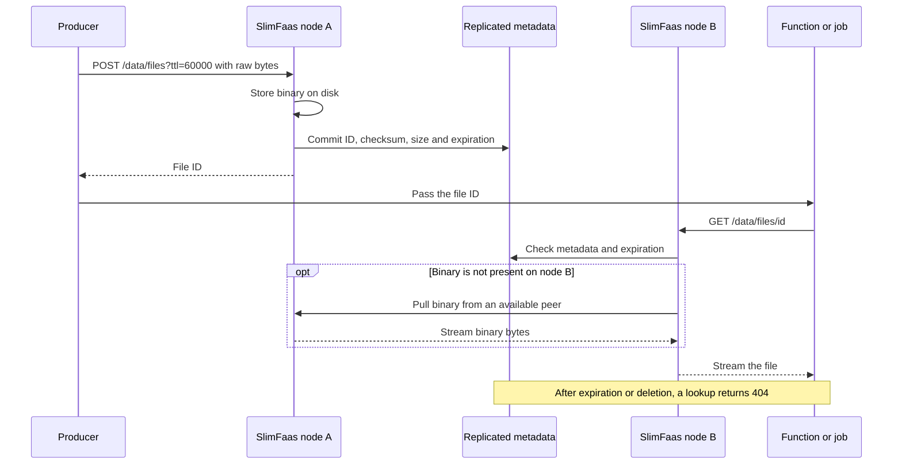
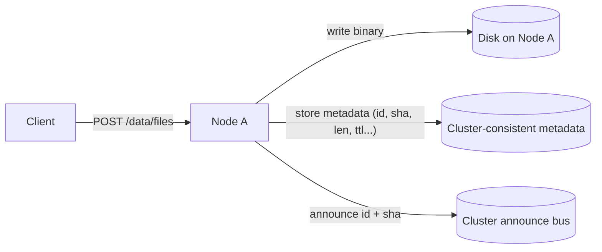
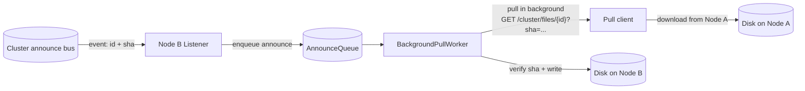
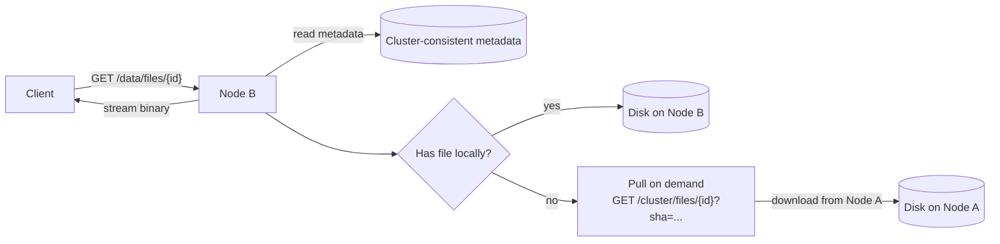

# Data temporary binary API

SlimFaas provides **temporary binary storage** through the **`/data/files`** endpoints.
This feature is designed for internal workflows (functions, jobs, agents, pipelines) that need to store and retrieve **binary artifacts** (PDF, ZIP, audio, PPTX, etc.) for a limited time.

This page explains:
- how to use the `/data/files` API,
- how it works internally (cluster behavior, safety limits),
- how to configure **Public vs Private** access and override it via **environment variables**.

---

## What is `/data/files` for?

Use `/data/files` when you need:

- a simple temporary store for binary artifacts
- a way to retrieve an artifact from any node in a SlimFaas cluster
- a solution that avoids shipping large binaries through the cluster’s consensus layer

**Core idea**
- The **binary content** is stored on **disk**.
- The **metadata** (checksum, size, content type, filename, TTL) is stored in a **cluster-consistent store** so every node knows “what exists”.

---

## Follow a temporary artifact

An upload returns an ID you can pass to a function or job. Consumers use that ID through the API; metadata is replicated through Raft, while binary bytes travel directly between nodes when needed.



The [file exercise](guided-tour.md#files) uploads the supplied fixture and compares the downloaded bytes. The dashboard shows traffic; use API responses to verify the file itself.

## API summary

Base path: `/data/files`

Empty files are valid. A peer transfer with `Content-Length: 0` persists an
empty artifact and verifies its SHA-256 just like a nonempty file. Earlier
versions incorrectly treated zero as a missing peer Content-Length, making an
accepted empty upload unavailable on nodes that had to fetch its bytes.

Local availability checks read the stored body and compare its length and
SHA-256 with the metadata. A truncated or modified local body is treated as
unavailable so the existing peer-pull path can attempt repair. Verification is
streamed with bounded memory; it adds a local read and hash calculation.

Verification reads reuse a 128 KiB scratch buffer, clearing it before return to
the pool. Full-body SHA-256 and length checks still precede persistence receipts
and availability decisions. This read buffer is independent of the WAL geometry
and the async body offload threshold.

Peer downloads verify the expected length and SHA-256 while the body is still
temporary. A truncated transfer or checksum mismatch is discarded without
replacing or deleting a previously valid local version. This uses the upload's
existing streaming hash calculation. The default acceptance policy does not
require a remote durable-copy acknowledgement; the opt-in policy is described
below.

When an existing ID changes checksum, the repository retains body revisions by
SHA-256. Peer HEAD/Range requests and queued reads select the requested checksum,
so publishing a replacement locally does not remove bytes still named by Raft
metadata. Fresh IDs and same-checksum repairs retain the existing two-file
layout. The historical current-body path remains readable; revision links on
the same volume share bytes and count as one replica.

Cleanup checks the durable checksum, queue and DLQ references before retiring a
revision. An earlier local upload expiry cannot override a still-live Raft
reference. A released revision is deleted separately from a newer revision;
unreferenced, unexpired bodies retain the existing three-observation grace.
This grace does not provide durable admission protection or confirm remote
copies. Those guarantees remain under investigation in the
[reliability follow-up](reliability/2026-11-15/README.md).

| Method | Path | Purpose |
|---|---|---|
| `POST` | `/data/files?id={id?}&ttl={ms?}` | Store a binary artifact (request body = raw bytes) |
| `GET` | `/data/files/{id}` | Download an artifact (auto-pull from another node if missing locally) |
| `DELETE` | `/data/files/{id}` | Remove metadata and delete the local binary |
| `GET` | `/data/files` | List known artifacts (metadata-based) |

---

## Store an artifact: `POST /data/files`

### Request contract

- Body: **raw bytes** (not multipart/form-data)
- **`Content-Length` is recommended** (for accurate concurrency accounting)
- Recommended headers:
    - `Content-Type` (defaults to `application/octet-stream`)
    - `Content-Disposition` (to provide a download filename)

Query parameters:

- `id` (optional): artifact identifier
    - If omitted, SlimFaas generates an id.
    - Use URL-safe ids (letters, numbers, `.`, `_`, `-`).
- `ttl` (optional): time-to-live in **milliseconds**
    - Example: `ttl=600000` (10 minutes)

### Content-Length behavior (when missing or unknown)

SlimFaas streams the request body to disk. For its transfer safety guard (see **256 MiB parallel limiter**), SlimFaas normally relies on `Content-Length` to “reserve” the right byte budget.

If `Content-Length` is **missing** or **unknown** (e.g., chunked transfer encoding), SlimFaas:

- **accepts the upload**
- logs a **warning**
- reserves the full default transfer budget (**256 MiB**) so an unknown-size upload runs alone

> Recommendation
> Provide `Content-Length` whenever possible to get accurate concurrency behavior (especially behind proxies).

### Responses

- `200 OK` with the artifact id as plain text
- `400 Bad Request` if the id is invalid

### Examples (curl)

Store an artifact for 10 minutes and keep a filename:

```bash
curl -X POST "http://<slimfaas>/data/files?ttl=600000"   -H "Content-Type: application/pdf"   -H "Content-Disposition: attachment; filename=\"report.pdf\""   --data-binary @./report.pdf
```

Store an artifact with a chosen id:

```bash
curl -X POST "http://<slimfaas>/data/files?id=my-artifact-001&ttl=300000"   -H "Content-Type: application/octet-stream"   --data-binary @./payload.bin
```

---

## Download an artifact: `GET /data/files/{id}`

### What happens on a download

When you request an artifact:

1. SlimFaas applies a Raft read barrier and reads the **cluster-consistent metadata** for `{id}` (checksum, size, content type, filename, TTL)
2. It checks whether the binary exists locally and matches the expected checksum
3. If missing, SlimFaas attempts to **pull** the binary from another cluster node that has it
4. The response streams the binary to the client

After a create or overwrite returns `200 OK`, a later download through any
healthy cluster node uses the latest committed metadata. A follower waits until
that metadata is applied locally instead of serving an older checksum.

### Responses

- `200 OK` streamed response
    - `Content-Type` from metadata (fallback `application/octet-stream`)
    - a download filename if provided at upload time
- `400 Bad Request` if id is invalid
- `404 Not Found` if metadata is missing/expired, or if no node can provide the binary
- `503 Service Unavailable` if the Raft quorum cannot guarantee a current metadata read

### Example (curl)

```bash
curl -L "http://<slimfaas>/data/files/my-artifact-001" -o my-artifact-001.bin
```

---

## Delete an artifact: `DELETE /data/files/{id}`

This removes the cluster-consistent **metadata** and immediately attempts to remove the
binary stored on the node handling the request. Other replicas remove their orphaned
copy after three cleanup observations (at most about 90 seconds with the default interval).

- `204 No Content` on success
- `400 Bad Request` if id is invalid

Physical cleanup is best-effort: the metadata deletion remains authoritative and a
background cleaner retries local orphan cleanup.

---

## List artifacts: `GET /data/files`

Returns the list of known artifact ids (metadata-based) and their expiration information (if any). Expired entries are not returned.

Example:

```bash
curl -s "http://<slimfaas>/data/files"
```

---

## Visibility & security (Public vs Private)

All `/data/files` routes are protected by a **data visibility** setting.

In `appsettings.json`:

```json
{
  "Data": {
    "DefaultVisibility": "Private"
  }
}
```

### Behavior

- **Public**: anyone who can reach SlimFaas can call `/data/files`
- **Private** (recommended): only **internal** requests are allowed
  External requests are typically answered with **404 Not Found** (intentionally “hidden”).

---

## Overriding visibility via environment variables

SlimFaas supports standard configuration overrides via environment variables.

To override:

- `Data:DefaultVisibility`

Use:

- `Data__DefaultVisibility`

### Example: set `/data/files` to Public

#### Docker / Docker Compose

```bash
export Data__DefaultVisibility=Public
```

#### Kubernetes Deployment (excerpt)

```yaml
env:
  - name: Data__DefaultVisibility
    value: "Public"
```

To keep it private (explicit):

```yaml
env:
  - name: Data__DefaultVisibility
    value: "Private"
```

> Notes
> - This setting affects all data routes that are guarded by the same visibility filter, including `/data/files`.
> - Use `Public` / `Private` for clarity.

---

## How it works internally (high-level)

### 1) Metadata is cluster-consistent; content is disk-backed

For `/data/files`:

- **metadata** is stored in a cluster-consistent store so every node has the same view of what exists and how to serve it
- **binary content** is stored on disk on the node that received the POST request

This avoids moving large binaries through the cluster’s consensus layer.
Metadata reads are linearizable: followers synchronize to the leader's current
commit index before selecting the checksum to serve. Binary distribution remains
eventual; an on-demand pull supplies the committed version when it is not yet
present on the node handling the download.

### 2) Cluster distribution model: announce + pull

SlimFaas does not block the POST by pushing the binary to all nodes.

Instead:

1. The node that stored the artifact announces “I have `{id}` with checksum `{sha}`”
2. Other nodes can **pull** the artifact in the background
3. If a client requests an artifact from a node that doesn’t have it locally, that node can **pull on demand**

This yields eventual distribution with minimal upload latency.

### Diagrams (simplified)

#### Step 1: Post /data/files

#### Step 2: Background announce handling

#### Step 3: Get /data/files/{id}


---

## The 256 MiB parallel limiter (safety guard)

SlimFaas applies a safety guard that limits concurrent binary transfers to roughly:

- **256 MiB in parallel**

Meaning:

- each in-flight transfer reserves a “byte budget” equal to its size
- new transfers wait if starting them would exceed the budget
- a single artifact larger than 256 MiB can run only if it is **alone**

When `Content-Length` is missing/unknown, SlimFaas reserves the complete default
budget (**256 MiB**) and logs a warning.

**This is not a strict memory cap**; it’s a concurrency limiter.

---

## Storage & durability

`/data/files` is disk-backed:

- If storage is ephemeral, artifacts may disappear on pod restart.
- For durability, mount a persistent volume.
- Artifacts can be re-pulled from other nodes only while at least one node still has the content **and** metadata still exists.

---

## Troubleshooting

### Upload logs a warning about Content-Length
Your client/proxy sent the request without `Content-Length` (often chunked transfer).

SlimFaas still accepts the upload and reserves the full **256 MiB** default budget.
The upload runs alone by default. Provide a known length (e.g. `curl --data-binary @file`)
to allow safe parallel transfers.

### File transfer memory settings

The defaults can be overridden with `SlimData__Files__...` environment variables:

```json
{
  "SlimData": {
    "Files": {
      "MaxInFlightBytes": 268435456,
      "UnknownLengthReservationBytes": 268435456,
      "MaxPendingTransfers": 128,
      "QueueWaitTimeoutSeconds": 30,
      "DropPageCache": true,
      "DurableWrites": false,
      "RequiredDurableCopies": 0,
      "AdmissionTimeoutSeconds": 120,
      "ReconcileIntervalSeconds": 5,
      "ReconcileBatchSize": 16,
      "ReconcileMaxBytes": 33554432
    }
  }
}
```

When the pending queue is full or a transfer waits longer than the configured timeout,
SlimFaas returns `429 Too Many Requests` with `Retry-After: 1`.

### Local persistence barriers

On Linux and macOS, `SlimData__Files__DurableWrites=true` flushes body and
metadata files to disk and synchronizes the directories that publish them
before the repository reports success. A flush or directory-sync failure is
returned as an error. The default remains `false` while the additional cost is
measured. Enabling this local policy does not confirm a remote copy or provide
the two-node acceptance guarantee under investigation.

Directory publication needs its own synchronization after file writes and
renames; see the [Linux fsync documentation](https://man7.org/linux/man-pages/man2/fsync.2.html).
.NET 11 uses `F_FULLFSYNC` on macOS with an `fsync` fallback and propagates
errors, as shown by its [runtime implementation](https://github.com/dotnet/runtime/blob/v11.0.0/src/native/libs/System.Native/pal_io.c).
This policy requires a filesystem that honors these barriers; Windows directory
durability is not claimed by this setting.

The built-in repository can also produce an explicit persistence receipt for a
requested ID, checksum and length. It rereads and verifies the body, flushes
body/metadata and publishes the directories before returning a storage identity
persisted at the configured data root. The cluster copy primitive uses the
existing message bus and Range transfer to obtain such a receipt from a known
peer; announcement confirmations do not satisfy it. It rejects mismatched
identity/checksum/length and a shared declared storage identity.

SlimFaas anchors this identity at `SlimData:Directory`, outside the per-pod
Raft log directory. Two node subdirectories under the same declared root share
one identity and cannot count as separate storage copies. Standalone SlimData
falls back to its log root when no directory is declared. Older per-node marker
files remain untouched during this correction; they are no longer the authority
when an enclosing volume root is declared. Independent backing storage still
requires deployment verification.

Peer lookup tries the remaining members when a remote `HEAD` fails. Each probe
has a five-second deadline so an unreachable or silent first peer cannot keep
hiding a surviving copy. Caller cancellation still stops the search immediately;
Range transfer checks and the enclosing operation deadline continue to apply.

Native `slimfaas local up` places its nodes under one declared data root. This
shared-root deployment cannot satisfy policy `2`: a second node in that root
does not provide a distinct-volume receipt, so the upload returns `503` rather
than acknowledging the stronger contract. Use policy `0` or `1` for this local
layout. Validate policy `2` with separate declared persistent volumes; separate
marker UUIDs alone do not establish independent physical backing storage.

### Durable acceptance policy under validation

`SlimData__Files__RequiredDurableCopies` selects the acceptance path:

- `0` (default): historical local-save and announcement acceptance.
- `1`: an explicit local persistence receipt, followed by atomic reference
  publication. This is also the local-only cost comparison variant.
- `2`: local persistence and a verified persisted-copy receipt from a distinct
  known node and declared volume, followed by atomic reference publication.

Policies `1` and `2` require Linux or macOS. They explicitly persist the selected
file version even when the independent `DurableWrites` setting is false.
An admission pin is committed before saving the body. Metadata and the async
queue entry, or public file alias, are subsequently published in one Raft
mutation before returning `202` or Files `200`. A missing, invalid or unavailable
copy prevents publication and returns `503`; capacity failures retain `429`.
An uncertain HTTP result may still correspond to a committed operation and must
remain distinct from confirmed acceptance. Storage replication does not make
function execution exactly once.

With policy `2`, the intended failure model is a stable three-member cluster
with independent persistent volumes that honor the flush barriers: losing any
one node and its volume after acceptance should leave a persisted copy while
the reference is needed. Distinct root markers identify declared storage domains;
they cannot prove independent backing hardware. Membership is checked again
before publication; a removed confirmed member causes rejection. Concurrent
reconfiguration, arbitrary multiple volume failures and dishonest storage barriers
are outside that single-failure model. The dedicated volume-loss fault matrix and
final performance cost are still pending; see the
[reliability investigation](reliability/2026-11-15/README.md).

Durable public uploads use a fresh physical ID behind the requested public name.
Replacing a name releases the previous alias without reusing its physical ID.
`GET`, listing and response IDs retain the public name; historical metadata stays
readable. `DELETE` removes that alias, and physical copies are retired later.
When supplied, a durable upload TTL must be positive (`400` otherwise). Queue,
retry, callback and DLQ/replay owners retain their bodies until the final owner
is released. Pending admissions expire after `AdmissionTimeoutSeconds` (1–600).
Late commands cannot revive an expired or retired admission.

### Incremental repair and cleanup

After a linearizable Raft read, a background worker checks active admissions and
legacy file references against local bytes. Announcements accelerate transfer;
lost notifications do not remove the periodic repair path. This work does not
block general readiness or replace on-demand pulls.

Each tick selects at most `ReconcileBatchSize` references using bounded temporary
storage. One transfer runs at a time under the existing transfer limits, with
`ReconcileMaxBytes` as the per-tick byte budget; one larger file can proceed to
avoid starvation. The worker stops starting files after five seconds, and an
individual repair uses `QueueWaitTimeoutSeconds` as its cancellation deadline.
The next tick runs after `ReconcileIntervalSeconds`. Released managed copies
require a Raft retirement decision before deletion. Expired aliases are deleted
conditionally, so an old TTL observation cannot delete a replacement upload.

Range reads retry I/O interruptions at the last successfully returned offset,
at most twice per stream. Caller cancellation and chunk timeouts are not retried.
Complete length/SHA-256 verification still precedes publication. A restarted
process retries an unfinished file from the beginning; partial transfers are
not durable resumable artifacts. Later reference scans revisit failed repairs.

### 404 Not Found on download
- metadata expired or was deleted
- no node currently has the binary (restart, cleanup, ephemeral storage)
- temporary unavailability during cluster convergence

---

## Quick reference

Admission mutations and persisted-copy results use generated MemoryPack dispatch,
including their surrounding SlimData batches. This avoids the first-use formatter
initialization window reproduced as an HTTP 500 under concurrent uploads; the
wire format and durability/acceptance rules are unchanged. See the
[initialization investigation](reliability/2026-11-15/admission-root-registration.md).

- Store: `POST /data/files?id={id?}&ttl={ms?}`
- Download: `GET /data/files/{id}`
- Delete: `DELETE /data/files/{id}`
- List: `GET /data/files`
- Visibility config: `Data:DefaultVisibility = Public | Private`
- Env override: `Data__DefaultVisibility=Public`

## Live metadata inventory

The built-in dashboard's **Live Stream → Data** tab shows file keys, TTL and document sizes without fetching values or documents. Search by prefix, inspect expiration and navigate pages of 100 entries. The inventory updates at the configured status interval; short-lived entries between snapshots may be missed.

Metadata follows the existing data visibility policy unless `SlimFaas__ExposeDataMetadata=true` explicitly enables metadata access for dashboard visitors. This does not grant access to stored contents. See [the dashboard inventory and SSE API](user-interface.md#data-inventory).

### Live traffic visualization

The dashboard animates authorized API calls through SlimFaas to its logical store, including reads, lists, writes and deletes. Set numeric operations are included. Store boxes show unexpired item counts and logical byte totals without exposing contents. See [Data API traffic and store counters](user-interface.md#data-api-traffic-and-store-counters) for metadata access and animation behavior.

## Overwrites during active reads

File and metadata readers share read, write and deletion access so Windows
can replace a version while another request opens or finishes reading it.
An already-open download stream retains its opened version while a later
request can open the replacement. This prevents sharing-violation errors when
an ID is overwritten while a replica is still reading it. Writes create a
temporary file before replacing the version; they do not edit an open body.

This Windows correctness fix is separate from the M4 throughput and async
quorum investigations in [the PR 504 follow-up](performance-pr504-followup.md).
