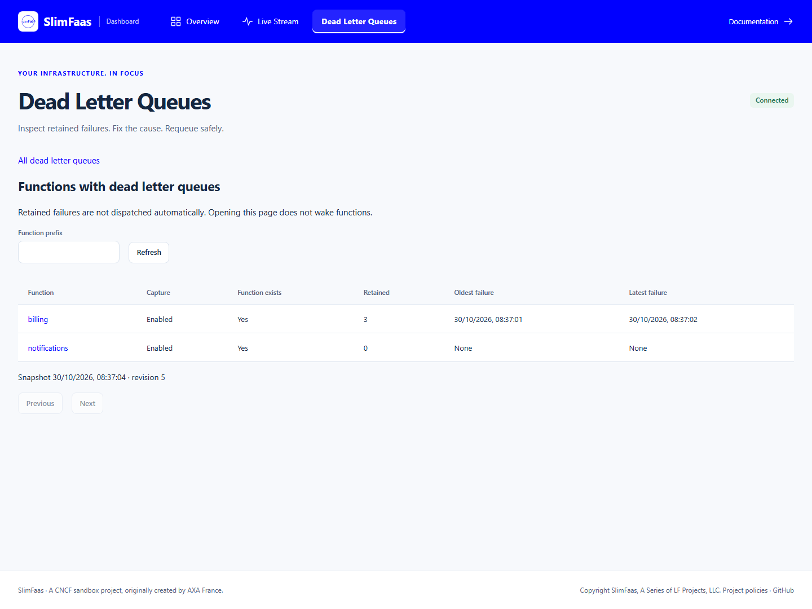

# Dead Letter Queues

A durable Dead Letter Queue (DLQ) retains terminal failures of accepted
asynchronous HTTP and WebSocket functions. Each function has one DLQ shared
across SlimFaas nodes and replicas. Capture is **disabled by default**.
Sync calls, publications, jobs, and requests rejected before durable acceptance
do not enter these queues.

## Enable capture

```yaml
metadata:
  name: billing
  annotations:
    SlimFaas/Function: "true"
    SlimFaas/Configuration: |
      {
        "DefaultAsync": {
          "HttpTimeout": 120,
          "TimeoutRetries": [2, 4, 8],
          "HttpStatusRetries": [500, 502, 503, 504],
          "DeadLetterQueue": {
            "Enabled": true,
            "MaxAgeSeconds": 604800,
            "MaxLength": 10000
          }
        }
      }
```

The default retention is seven days and 10,000 entries per function. Both
limits must be positive integers. Age starts at terminal failure, not initial
acceptance. Expiration and oldest-first count eviction release payload
references. These are count/age limits, **not byte quotas**; existing admission
and global storage limits still apply. New entries use the current age limit;
changing it does not rewrite existing expiration timestamps.

Final 2xx responses except 202 complete successfully. A 202 keeps the execution
pending, including its concurrency slot, until a completion callback or timeout.
Failures use the accepted request's retry policy. A nonretryable non-success
response enters the DLQ immediately; exhausting retries also enters the DLQ.
The stored reason distinguishes `RetriesExhausted`, `NonRetryableResponse`,
`DeliveryTimeout`, `CallbackError`, `CallbackTimeout`, and `TransportError`.

```http
POST /async-function-callback/billing/{elementId}/success
POST /async-function-callback/billing/{elementId}/error
```

Disabling capture or removing a function does not purge retained entries.
They remain inspectable/deletable until retention ends; replay requires the
same function to exist. Retained messages never run automatically, consume
execution slots, keep functions awake, or contribute to executable backlog.

## Visibility and dashboard defaults

```json
{
  "SlimFaas": {
    "EnableFront": true,
    "DeadLetterQueue": {
      "DefaultVisibility": "Private",
      "EnableFront": false
    }
  }
}
```

`Private` reuses the existing trusted-caller policy and returns 404 for
unauthorized callers. It protects all DLQ reads, bodies, actions, replay
receipts, metrics, and live summaries/activity. Public function visibility,
Data visibility, and `ExposeDataMetadata` do not grant DLQ access.

**Setting `DefaultVisibility` to `Public` explicitly exposes original payloads
and management actions, including replay and deletion.** Do this only in a
trusted environment or behind an independently authenticated gateway.

The two dashboard surfaces require both `SlimFaas:EnableFront` and
`SlimFaas:DeadLetterQueue:EnableFront`, plus caller authorization. The specific
front flag does not disable REST APIs or capture. In environment variables:

```bash
export SlimFaas__DeadLetterQueue__EnableFront=true
export SlimFaas__DeadLetterQueue__DefaultVisibility=Private
```

Dashboard links:

- `/#/dead-letters`: searchable function catalog.
- `/#/dead-letters/billing`: filtered, paginated retained messages.
- `/#/dead-letters/billing/messages/{messageId}`: details and replay lineage.
- Live Stream > Traffic: distinct active queue and DLQ actors, retained counts,
  function/event filters, and links from function details and journal entries.

Bodies load only after **Preview body** or **Download body**. Preview is capped
at 64 KiB, marks truncation, and displays HTML/JSON as inert text. Download
streams the original bytes with the original content type as an attachment.
Neither opening the page nor inspecting a body wakes a function.

### Illustrated example

These captures use a real three-node native-local cluster with synthetic
`billing` requests returning HTTP 400 and an empty `notifications` DLQ.
After fixing the application, the **Requeue** action creates a new execution
and the Traffic journal records `dead letter requeued`. The HTML example has
a 2.1 MiB offloaded body; its 64 KiB preview remains inert.



| View | Example |
|---|---|
| [Filtered message list](images/dashboard/dlq-messages.png) | Failure reason, HTTP status, attempts, retention and request sizes |
| [Message detail and JSON preview](images/dashboard/dlq-message-detail.png) | Original request, replay/delete actions and explicit body download |
| [Bounded HTML preview](images/dashboard/dlq-bounded-preview.png) | Inert text, truncation notice and full-body download |
| [Overview function details](images/dashboard/dlq-function-details.png) | Retained count and direct DLQ link |
| [Traffic DLQ actor details](images/dashboard/dlq-traffic-details.png) | Separate DLQ actor, retained count and management link |
| [Replay event journal](images/dashboard/dlq-replay-journal.png) | Function/event filters and the DLQ-to-function replay transition |
| [Mobile catalog](images/dashboard/dlq-mobile-catalog.png) | Responsive navigation and horizontally scrollable inventory |

## Management API

| Method | Route | Result |
|---|---|---|
| GET | `/data/dead-letters` | Function catalog |
| GET | `/data/dead-letters/{function}` | Summary, retention and revision |
| GET | `/data/dead-letters/{function}/messages` | Message metadata page |
| GET | `/data/dead-letters/{function}/messages/{messageId}` | Original request metadata and failure |
| GET | `/data/dead-letters/{function}/messages/{messageId}/body` | Original body; byte ranges where seekable |
| POST | `/data/dead-letters/{function}/messages/{messageId}/requeue` | Durable replay receipt |
| DELETE | `/data/dead-letters/{function}/messages/{messageId}` | Delete retained failure |
| GET | `/data/dead-letters/-/metrics` | Access-controlled Prometheus metrics |

Identifiers are safe path segments. Pages default to `limit=100`, at most 500.
Pass the opaque `NextCursor` back as URL-encoded `after`. Catalogs accept a
function `prefix`; message lists accept `reason` and `httpStatus`, applied
before oldest-first pagination. Listing does not consume messages or include
bodies/full request headers. Details can contain application headers and query
strings and should be treated as sensitive.

```bash
curl "$SLIMFAAS/data/dead-letters?limit=100"
curl "$SLIMFAAS/data/dead-letters/billing/messages?reason=NonRetryableResponse&httpStatus=400"
curl "$SLIMFAAS/data/dead-letters/billing/messages/$MESSAGE_ID"
curl -OJ "$SLIMFAAS/data/dead-letters/billing/messages/$MESSAGE_ID/body"
curl -X POST "$SLIMFAAS/data/dead-letters/billing/messages/$MESSAGE_ID/requeue"
curl -X DELETE "$SLIMFAAS/data/dead-letters/billing/messages/$MESSAGE_ID"
```

Responses: 200 read, 202 durable replay, 204 deletion, 400 invalid input,
404 absent/expired/inaccessible, 409 function or required payload unavailable,
429 admission capacity, and 503 temporary cluster/storage unavailability.
A blocked replay leaves the retained entry intact.

## Replay and recovery guarantees

Capture, deletion, retention, and replay are committed through SlimData/Raft.
Replay receipts use the generated MemoryPack serializer directly, retaining the
same stored bytes without generic virtual formatter dispatch in Native AOT builds.
Capture preserves the accepted request, retry history, failure time, and
inline or internally offloaded payload references in the same state transition
that removes it from the executable queue. Persistence failures are reported
and retried; a pending completion is not deliberately dispatched again just
to retry its transfer.

Replay atomically removes the retained entry and inserts a fresh execution in
the **same function's normal queue**. It preserves method/path/query/body and
application headers, generates fresh SlimFaas execution headers, resets attempts,
uses current retry settings, and participates in normal backpressure,
concurrency, wake-up, and autoscaling.

Concurrent/repeated replays return the same receipt for 24 hours, with
`DeadLetterId`, `OriginalElementId`, `ElementId`, and `Function`. An uncertain
response should be retried with that same DLQ ID. After receipt expiration
it returns 404, never inserts a second copy. Old callbacks cannot complete
the new element. A replay that fails again creates another DLQ entry with
lineage back to the original execution.

**202 means requeued, not processed successfully.** Application delivery is
still at-least-once; handlers must tolerate duplicate/partial side effects.

## WebSocket clients

Both SDKs already send a JSON configuration string; no new wire field is needed.
The runtime now validates and honors that string for retry/DLQ configuration.
All clients sharing a function name must use identical configuration.

```csharp
var config = new SlimFaasClient.SlimFaasClientConfig
{
    FunctionName = "billing",
    Configuration = """{"DefaultAsync":{"HttpTimeout":120,"DeadLetterQueue":{"Enabled":true}}}"""
};
```

```python
import json
from slimfaas_client import SlimFaasClientConfig

config = SlimFaasClientConfig(
    function_name="billing",
    configuration=json.dumps({"DefaultAsync": {"DeadLetterQueue": {"Enabled": True}}}),
)
```

Return the actual completion status from an async handler. For deferred work,
return 202 and send the existing explicit callback with its execution ID.
An offloaded body is loaded before delivery through the existing base64
WebSocket contract; that transport still materializes the body in memory.
See [client documentation](clients.md) and SDK examples.

## Observability and upgrades

`/data/dead-letters/-/metrics` exposes `slimfaas_dead_letters`,
`slimfaas_dead_letter_transitions_total{function,outcome}`, and node-local
`slimfaas_dead_letter_persistence_failures_total`. Scrape through an authorized
caller or authenticated gateway. These metrics deliberately do **not** enter
the generally accessible `/metrics` endpoint, which would bypass DLQ privacy.
Transition totals are persisted; do not sum the same replicated totals across
nodes. Persistence failures are local counters.

Authorized `state` SSE frames contain up to 500 DLQ summaries. Activity contains
only bounded transition/identity metadata, never bodies, full headers, or query
strings. Committed `dead_lettered`, `dead_letter_requeued`, `dead_letter_deleted`,
`dead_letter_expired`, and `dead_letter_evicted` events are best effort and can
be sampled/missed; use snapshots/API revisions as the source of truth.
The durable recent-transition window is bounded to 128 events per function,
not an exhaustive audit log. Structured logs include message IDs without bodies.

This feature advertises **SLDC/3**. Upgrade all Raft members together: mixed
SLDC/1, SLDC/2 and SLDC/3 nodes refuse mutation traffic until compatible.
Existing queue snapshots, WAL commands, and producer receipts remain readable.
See [unified batching](slimdata-unified-batching.md).

## Native local exercise

The overlay is opt-in; it does not alter the standard guided tour:

```bash
export SlimFaas__DeadLetterQueue__DefaultVisibility=Public # trusted local demo only
export SlimFaas__DeadLetterQueue__EnableFront=true
dotnet run --project src/SlimFaas -- local up -f ../../slimfaas.local.yaml -f ../../slimfaas.local.dlq.yaml
```

In another terminal:

```bash
export SLIMFAAS=http://127.0.0.1:30020
# Invalid JSON input is accepted by the gateway but fails in the sample handler.
curl -X POST "$SLIMFAAS/async-function/fibonacci1/fibonacci" \
  -H 'Content-Type: application/json' --data '{"Input":"not-a-number"}'
curl "$SLIMFAAS/data/dead-letters/fibonacci1/messages"
```

Inspect the retained body and failure in the dashboard. Fix the sample handler
to accept this input (or deploy the corrected application), then requeue the
same message. The payload is immutable: editing a failed message is not a
repair mechanism. Replaying before fixing the handler produces a new failure,
not a successful job. Delete the retained entry when it is no longer needed.
