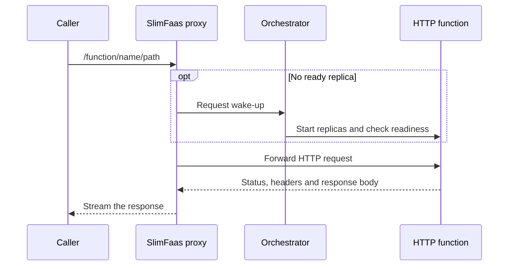

# SlimFaas Functions

SlimFaas supports synchronous and asynchronous HTTP calls. This page covers
synchronous invocation and shared function configuration. See
[Asynchronous Functions](async-functions.md) for durable queues, retries,
callbacks and Dead Letter Queues.

---

## Follow an invocation

For a synchronous call, the caller keeps its connection open while SlimFaas waits for a ready replica and proxies the response. A wake-up can therefore be visible before the first successful response.



An asynchronous call separates durable acceptance from execution. See the
[async architecture](async-functions.md#architecture-and-lifecycle), follow the
[Guided Tour](guided-tour.md#4-queue-work-retry-and-complete-callbacks), then
[scale out with an async burst](guided-tour.md#scale-from-n-to-m-with-an-async-backlog).

## 1. Synchronous Functions

Synchronous calls block until the underlying function pod handles the request and returns a response.

- **Route**:
  `GET/POST/PUT/... http://<slimfaas>/function/<functionName>/<path>`

- **Example**:
  GET http://localhost:30021/function/fibonacci1/hello/guillaume → 200 (OK) with response from fibonacci1

If your function has scaled to zero, SlimFaas automatically **wakes it up** and waits until at least one replica is ready (subject to internal timeouts).

---

## 2. Asynchronous Functions

Calls to `/async-function/{functionName}/{path}` return **202 Accepted after
durable enqueueing**, not after execution. The dedicated
[Asynchronous Functions](async-functions.md) page explains concurrency, retries,
deferred callbacks, and [DLQ capture and replay](async-functions.md#dead-letter-queues).

---

## 3. Wake Function

You can explicitly “wake up” a function without invoking a specific route:

- **Route**:
  `POST http://<slimfaas>/wake-function/<functionName>`

- **Response**:
  `204 (No Content)`

This is handy if you want to ensure the function is running before real traffic arrives.

---

## 4. Listing Functions

SlimFaas exposes a route to check the readiness status of all registered functions:

- **Route**:
  `GET http://<slimfaas>/status-functions`

- **Response**:
  An array of objects with details like `NumberReady`, `NumberRequested`, `PodType`, `Visibility`, etc.

```json
[
    {
      "NumberReady": 1,
      "NumberRequested": 1,
      "PodType": "Deployment",
      "Visibility": "Public",
      "Name": "fibonacci1"
    }
]
```

## 5. Private vs. Public Functions

By default, functions are **Public** (accessible from anywhere). You can specify them as **Private**—restricting access to calls originating from within the same namespace.

```yaml
metadata:
    annotations:
        SlimFaas/DefaultVisibility: "Private"
        # or define paths:
        SlimFaas/PathsStartWithVisibility: "Private:/mypath,Public:/otherpath"
        SlimFaas/DefaultTrusted: "Trusted"
```
This helps you control which services can call certain endpoints.

`SlimFaas/PathsStartWithVisibility` rules are evaluated in their declared order. The first matching path prefix determines visibility; matching ignores case and an optional leading `/`. Rules that do not match are skipped silently. If no rule matches, `SlimFaas/DefaultVisibility` applies (Public when omitted).

The `Public:` and `Private:` prefixes are parsed when the configuration is loaded. In status responses, each rule therefore has separate `Path` and `Visibility` fields; the prefix is not part of `Path`. Event subscription visibility is configured separately through [`SlimFaas/SubscribeEvents`](events.md#1-subscribe-to-events).

An **Untrusted** function will be considered as outside the namespace and will not be able to access Private actions.  By default, a function is **Trusted**.

```yaml
metadata:
    annotations:
        SlimFaas/DefaultTrusted: "Trusted" # Trusted or Untrusted
```

### How callers are classified

A call is **internal** when the source address of its TCP connection is the address of a Trusted function pod or of a job pod. The comparison is exact (`10.0.0.1` never matches `10.0.0.10` or `110.0.0.1`), and IPv4-mapped IPv6 addresses compare equal to their IPv4 form.

The `X-Forwarded-For` header is **ignored by default**: a caller cannot become internal by forging it. If a reverse proxy sits between the callers and SlimFaas and must pass the original client address, declare it in `SlimFaas:TrustedProxies` (IP addresses or CIDR networks). SlimFaas then honours **one hop** of `X-Forwarded-For`, and only for connections coming from those proxies:

```yaml
env:
  - name: SlimFaas__TrustedProxies__0
    value: "10.0.0.5"          # a reverse proxy with a fixed address
  - name: SlimFaas__TrustedProxies__1
    value: "10.250.1.0/28"     # a subnet reserved for the ingress controller only
```

> **Warning.** `TrustedProxies` controls **authorization**, not just request attribution: every address in the list may declare any client address and therefore reach Private functions and peer endpoints on behalf of a Trusted pod. Declare only addresses owned exclusively by the proxy: its fixed IP, or a subnet that contains nothing but proxy instances. Never declare the whole pod CIDR (for example `10.244.0.0/16` on a common cluster network) or any subnet in which ordinary workloads can be scheduled; doing so reopens the header spoofing this check prevents.

Source addresses remain a weak identity: sidecars share the pod address, and a call that reaches a function pod without going through SlimFaas is not checked by SlimFaas. Use a NetworkPolicy to restrict the function ports to SlimFaas when that matters.

## 6. Function Configuration

You can configure the synchronous HTTP timeout and the retry policies used by asynchronous and publish calls with `SlimFaas/Configuration`:

```json
{
  "DefaultSync": {
    "HttpTimeout": 120
  },
  "DefaultAsync": {
    "HttpTimeout": 120,
    "TimeoutRetries": [2,4,8],
    "HttpStatusRetries": [500,502,503]
  },
  "DefaultPublish": {
    "HttpTimeout": 120,
    "TimeoutRetries": [2,4,8],
    "HttpStatusRetries": [500,502,503]
  }
}
```

Synchronous calls make exactly one HTTP request and never retry. `DefaultSync` therefore supports only `HttpTimeout`.

`TimeoutRetries` defines the delays in seconds between attempts for asynchronous and publish calls. `HttpStatusRetries` lists the HTTP statuses that trigger those retries.

Every section is optional. When a section or property is omitted, SlimFaas applies its defaults. For example, the following configuration customizes only publish calls; sync and async keep their default 120-second timeout, and async keeps its default retry policy:

```json
{
  "DefaultPublish": {
    "HttpTimeout": 15,
    "TimeoutRetries": [1,2,4],
    "HttpStatusRetries": [500,502,503]
  }
}
```

---

## 7. The DependsOn Annotation

You can also add a `DependsOn` annotation to specify that your function should wait for certain other pods to be ready before it scales up from zero. For example:

```yaml
metadata:
    annotations:
        SlimFaas/Function: "true"
        SlimFaas/ReplicasMin: "0"
        SlimFaas/ReplicasAtStart: "1"
        # ...
        SlimFaas/DependsOn: "mysql,fibonacci2"
```
- **mysql** and **fibonacci2** are the names of other deployments/statefulsets in the same namespace.
- SlimFaas will not scale the current function (e.g., `fibonacci1`) unless all pods listed in `DependsOn` are in a ready state and meet their own minimum replicas.

This is useful in scenarios where your function must not start until a database or another dependent function is confirmed running.

## 8. Scheduling Function Wake-Up and Scale-Down
If you want your function to automatically wake at a specific time or change its scale-down timeout based on the time of day, use the SlimFaas/Schedule annotation with a JSON configuration. This feature is especially useful for workloads with predictable peak/off-peak hours.

Example Annotation
```yaml
metadata:
  annotations:
    SlimFaas/Schedule: >
      {
        "TimeZoneID": "Europe/Paris",
        "Default": {
          "WakeUp": ["07:00"],
          "ScaleDownTimeout": [
            { "Time": "07:00", "Value": 20 },
            { "Time": "21:00", "Value": 10 }
          ]
        }
      }
```

### Configuration Details
- `TimeZoneID`
Defines which IANA time zone to use (e.g., `"Europe/Paris"`).
You can see the full list of valid time zone IDs here: https://nodatime.org/TimeZones

- `WakeUp`
An array of times (`HH:mm`) at which the function should be woken up automatically.
For example, `"07:00"` means that each day at 07:00 local time, the function will scale to its `ReplicasAtStart` value (rather than remain at zero).

- `ScaleDownTimeout`
An array of objects containing:
    - `Time`: A local time string (e.g., `"07:00"`).
    - `Value`: The inactivity timeout (in seconds) that applies after this time.
      - For instance, `{"Time":"07:00","Value":20}` sets a 20-second inactivity timeout from 07:00 until another time checkpoint is reached.
      - `{"Time":"21:00","Value":10}` sets a 10-second inactivity timeout from 21:00 onward.

### How It Works
1. **At each specified time**, SlimFaas updates the function’s wake-up behavior or scale-down timeout in accordance with the schedule.
2. **Waking up** a function ensures at least one replica is running at that time.
3. **ScaleDownTimeout** adjusts how quickly the function is allowed to scale back to zero if there is no traffic.

### Example Use Case
- **07:00**: Wake up the function to be immediately available for peak morning traffic. The inactivity timeout becomes 20 seconds. If no traffic arrives for 20 seconds, the function could scale back to zero.
- **21:00**: Reduce the inactivity timeout to 10 seconds, allowing a quicker scale-down in the evening/off-peak period.

This scheduling feature helps you maintain availability during predictable high-demand periods while efficiently saving resources during low-demand times.


## 9. Key Annotations for Functions

Before you start calling functions, ensure you add the necessary annotations to your Kubernetes Deployments or StatefulSets:

- **`SlimFaas/Function: "true"`**
  Activates SlimFaas auto-scaling and routing for this pod. Without this annotation, SlimFaas will ignore the pod.

- **`SlimFaas/ReplicasMin: "0"`**
  The minimum number of replicas to maintain for the function. Setting `0` allows the function to scale down to zero after inactivity.

- **`SlimFaas/ReplicasAtStart: "1"`**
  The number of replicas to initially wake up to when traffic arrives or when manually woken. Typically set to `1`.

- **`SlimFaas/TimeoutSecondBeforeSetReplicasMin: "300"`**
  The number of **inactivity seconds** after which the function will scale down to `ReplicasMin`. (Default is often `300` seconds.)

- **`SlimFaas/NumberParallelRequest: "10"`**
  The maximum number of concurrent requests allowed for all replicas. Additional requests will queue until a slot frees up.

- **`SlimFaas/NumberParallelRequestPerPod: "10"`**:
  The maximum number of concurrent requests allowed per pod. Additional requests will queue until a slot frees up.


```yaml
# Example snippet from a Deployment
metadata:
    annotations:
        SlimFaas/Function: "true"
        SlimFaas/ReplicasMin: "0"
        SlimFaas/ReplicasAtStart: "1"
        SlimFaas/TimeoutSecondBeforeSetReplicasMin: "300"
        SlimFaas/NumberParallelRequest: "10"
        SlimFaas/NumberParallelRequestPerPod: "10"
```

---

## 10. Asynchronous Function Execution: Control Callback Mode

See [deferred completion callbacks](async-functions.md#deferred-completion-callbacks) for execution headers, timeout handling, and HTTP/WebSocket completion. A callback never sends a later response on the original caller connection.
