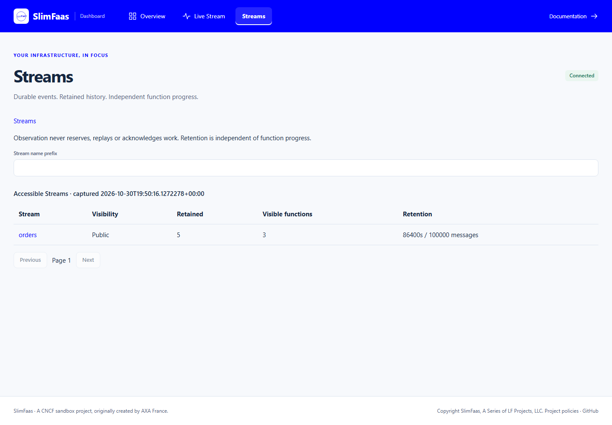
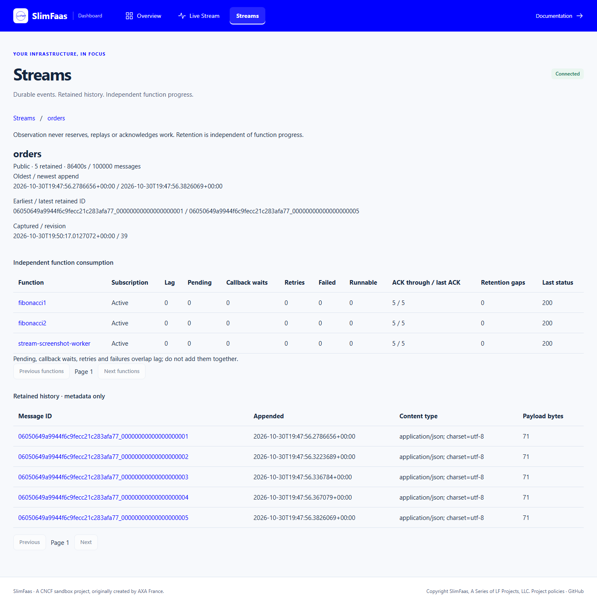
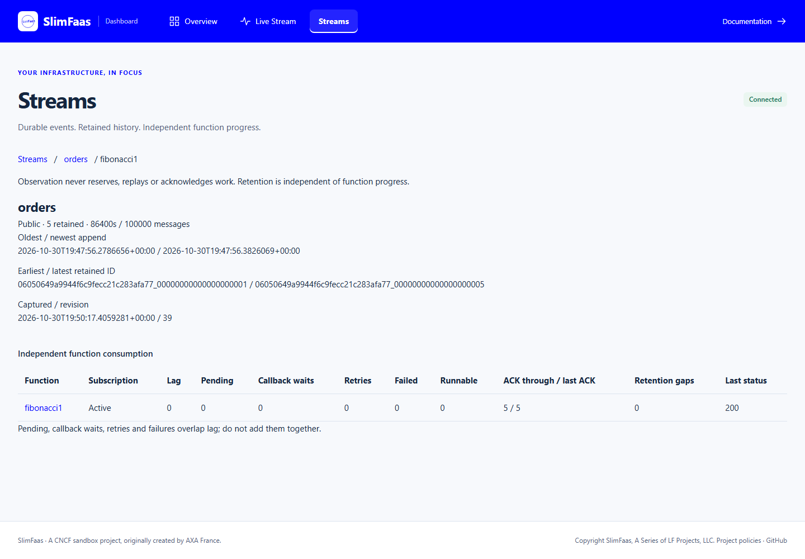
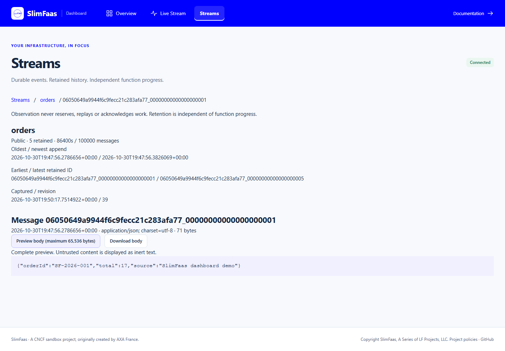
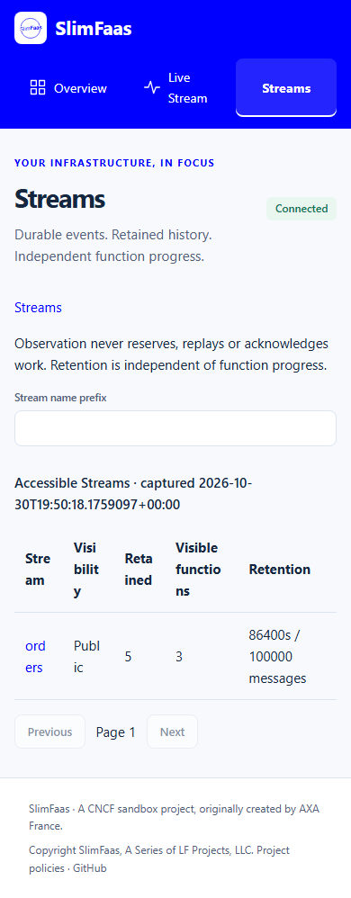
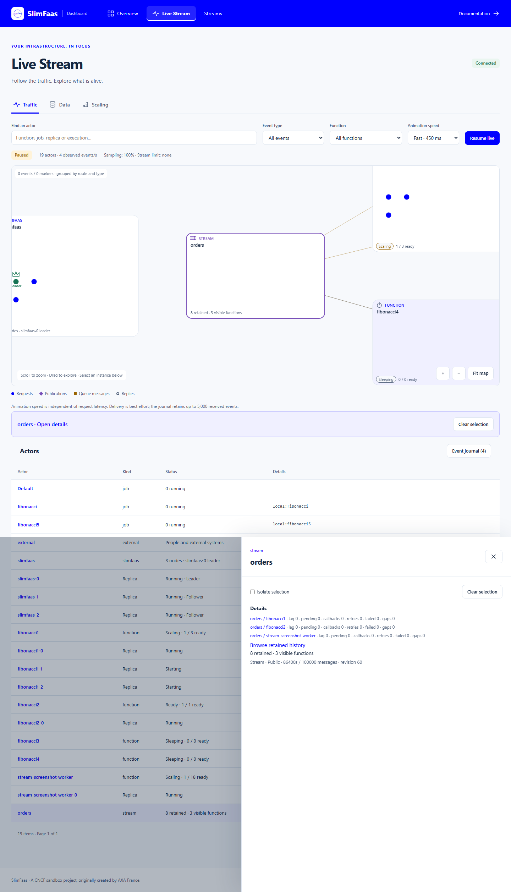
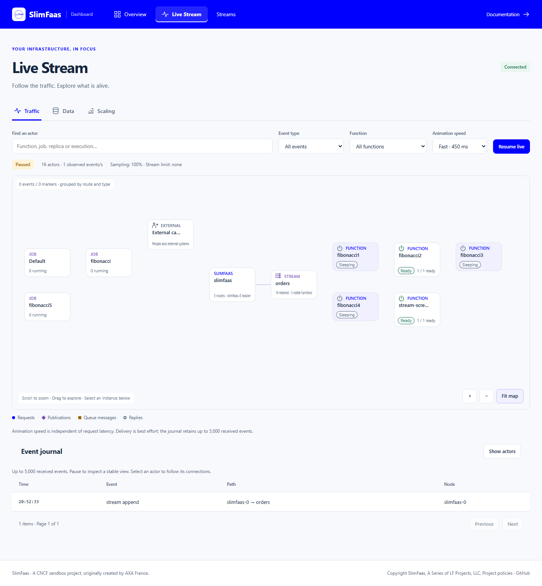

# Durable Streams

Streams are bounded, ordered event logs replicated by SlimData/Raft. Unlike
[Events](events.md), they retain publications for sleeping functions. Unlike an
async queue, each subscribed **function** consumes independently. Replicas of one
function share its consumption state; one replica receives each attempt.

## Dashboard gallery

The dashboard's **Streams** page includes a retained Stream catalog, per-Stream
history, independent function progress and message details. Body previews are
bounded and render untrusted payloads as inert text.









The catalog also adapts to narrow screens:



Live Traffic represents a Stream as a distinct actor. Its details link to
retained history and list subscriber progress; the event journal includes
Stream lifecycle and delivery events.





## Configure a function

```yaml
metadata:
  name: billing
  annotations:
    SlimFaas/SubscribeStream: "Private:orders,Public:notifications"
    SlimFaas/StreamMaxAge: "24h"
    SlimFaas/StreamMaxLength: "100000"
    SlimFaas/NumberParallelRequest: "10"
    SlimFaas/NumberParallelRequestPerPod: "5"
```

Unprefixed subscriptions inherit `SlimFaas/DefaultVisibility`. Retention defaults
to 24 hours and 100,000 messages. Age accepts positive integer seconds or an
integer followed by `s`, `m`, `h` or `d`. Names contain ASCII letters, digits,
hyphens, underscores or dots, up to 256 characters; `.` and `..` are invalid.
All declarations of a Stream must agree on visibility and retention. A conflict
is rejected, preserving the committed policy. To replace a policy, drain active
deliveries, delete the Stream and recreate it; this creates a new generation.

New subscriptions start at the committed tail, receiving **only subsequent
appends**. Explicitly removing and re-adding a subscription starts a new
generation at the then-current tail. A WebSocket disconnection is not an
unsubscribe: reconnecting with the same function and configuration resumes its
durable progress. All clients sharing a function name must use the same complete
registration configuration, including dependencies, retry policy and visibility.
Conflicting retained registrations fail even when the previous client is offline;
disconnect all clients and explicitly unsubscribe from every Stream before
replacing that configuration.

## Publish and deliver

```bash
curl -i -X POST http://localhost:5000/publish-stream/orders/compute \
  -H 'Content-Type: application/json' --data '{"orderId":"42"}'
```

Like publish/subscribe, the publisher chooses the application path. This example
delivers `POST /compute` with the original query, headers and body. Root append
`POST /data/streams/orders` delivers `POST /`. The `201` append receipt contains
`Stream` and `MessageId`, and a `Location` header; it confirms durable acceptance,
**not** function processing. Unknown Streams are created using Data's default
visibility and the default retention, subject to caller access.

The request body limit is 14 MiB. Prefer small messages referencing
[Data Files](data-files.md); reading a Stream never downloads referenced files,
extends their TTL or changes their access policy.

HTTP deliveries carry `SlimFaas-Stream-Name`, `SlimFaas-Stream-Message-Id`,
`SlimFaas-Element-Id`, `SlimFaas-Try-Number` and `Slimfaas-Last-Try`.
Final `2xx` excluding `202` acknowledges that function's attempt. `202` keeps
capacity reserved while waiting for the existing callback:

```http
POST /async-function-callback/billing/<SlimFaas-Element-Id>/success
POST /async-function-callback/billing/<SlimFaas-Element-Id>/error
```

Timeouts and retryable statuses use `Configuration.DefaultAsync`'s timeout and
retry policy. Attempts have persisted leases; stale attempt callbacks cannot
acknowledge a later attempt. Delivery is **at least once**: make handlers
idempotent using the Stream message ID. Concurrent completion can be out of
append order. Exhausted/non-retryable failures remain unacknowledged, stop
retrying, and do not block later messages or create endless scaling demand.
They are not automatically copied into async-function dead-letter queues.

## WebSocket functions

Both [official clients](clients.md) expose a dedicated Stream handler. Numeric
frame types and sync streaming are unchanged. Registration adds `subscribeStreams`,
`streamMaxAgeSeconds` and `streamMaxLength`. Servers advertise `streams-v1`;
clients requesting Streams reject servers that do not advertise this capability.
Delivery reuses `AsyncRequest` with additive `streamName` and `messageId`.

```csharp
var config = new SlimFaasClient.SlimFaasClientConfig {
    FunctionName = "billing-ws",
    SubscribeStreams = [new() { Name = "orders", Visibility = SlimFaasClient.FunctionVisibility.Public }]
};
await using var client = new SlimFaasClient.SlimFaasClient(new Uri("ws://localhost:5000/ws"), config);
client.OnStreamMessage = message => Task.FromResult(200);
await client.RunForeverAsync(CancellationToken.None);
```

```python
import asyncio
from slimfaas_client import SlimFaasClient, SlimFaasClientConfig, SubscribeStreamConfig, FunctionVisibility

async def main():
    config = SlimFaasClientConfig(
        function_name="billing-ws",
        subscribe_streams=[SubscribeStreamConfig("orders", FunctionVisibility.PUBLIC)])
    async with SlimFaasClient("ws://localhost:5000/ws", config) as client:
        async def handle(message):
            print(message.stream_name, message.message_id, message.element_id)
            return 200
        client.on_stream_message(handle)
        await client.run_forever()

asyncio.run(main())
```

Returning `202` from a Stream handler sends an intermediate callback and retains
the attempt until `SendCallbackAsync(elementId, status)` / `send_callback(...)`.
Returning an error or throwing does not acknowledge the message. Ordinary async
handler behavior is unchanged. External WebSocket processes are not launched or
scaled by SlimFaas; their backlog and shared capacity remain observable.

## Observe without consuming

All GETs below are passive and never reserve work, acknowledge messages or wake
functions. Pages contain `Items`, `NextCursor`, `CapturedAt` and `Revision`.
Default page size is 100; maximum is 500.

| Route (GET) | Result |
| --- | --- |
| `/data/streams?prefix=ord&after=<cursor>&limit=100` | Accessible catalog |
| `/data/streams/orders/metadata` | Retention, boundaries and visible function count |
| `/data/streams/orders?after=<messageId>&limit=100` | Retained message metadata |
| `/data/streams/orders/messages` | Same history |
| `/data/streams/orders/messages/<id>` | One message's metadata |
| `/data/streams/orders/messages/<id>/body` | Explicit inert attachment; supports byte ranges |
| `/data/streams/orders/functions?after=<cursor>` | Independent function summaries |
| `/data/streams/orders/functions/billing` | One subscription |

Use the returned cursor only with the same resource and filters. History outside
the retained generation/boundary returns `410`, including `EarliestMessageId`.
No bodies, credentials or application headers appear in metadata lists.

Advanced consumption APIs are `POST .../functions/{function}`, `POST
.../functions/{function}/read` (reserve) and `POST
.../functions/{function}/ack/{messageId}`. ACK requires the reservation's
`SlimFaas-Element-Id` header. Normal HTTP/WebSocket handlers do not call these.
`DELETE .../functions/{function}` explicitly unsubscribes, including an offline
WebSocket function. In-flight callbacks may finish; re-subscribing returns `409`
until they finish or expire. Remove HTTP subscription annotations first to
prevent a new leader from reconciling the subscription back into place.
`DELETE /data/streams/orders` returns `409` while a delivery or callback wait is
active; otherwise it deletes retained data and subscriptions.

### Counters and scaling

`RetainedMessageCount` counts stored messages, regardless of ACKs. `Lag` counts
retained, unacknowledged messages within the subscription's range. `PendingCount`
is the already-delivered subset of lag; callback waits, scheduled retries and
terminal failures overlap pending. **Do not add overlapping counters together.**
`RunnableCount` is lag excluding terminal failures, including active/callback
work only once. It feeds native scaling without an exporter, respects dependency
readiness, existing scaling policies and replica bounds, and permits idle
scale-to-zero. `AcknowledgedThrough` is contiguous successful progress;
`LastAcknowledged` alone does not prove earlier success. `RetentionGapCount`
reports lost unacknowledged messages, never successful ACKs.

### Visibility and dashboards

Private Streams require existing internal/trusted-workload access on **every**
route, including callbacks. A public function does not expose a private Stream.
Public Streams do not expose private function names/counts. Catalogs and SSE
state/activity are filtered per caller, independently of Data metadata exposure.

With `SlimFaas:EnableFront`, open `#/streams` for the catalog, Stream history,
function summaries and message detail. Bodies load only on explicit preview
(maximum 65,536 bytes, inert text) or download. The page uses the shared status
SSE with `activity=false`; it does not subscribe separately or reserve work.
Traffic displays distinct Stream actors and actual selected replica deliveries;
ACKs never animate removal. Live snapshots are bounded to 500 Streams and 500
subscriptions, with an explicit truncation flag; use paginated APIs for more.

## Native demo

```bash
dotnet run --project src/SlimFaas -- local up -f ../../slimfaas.local.yaml -f ../../slimfaas.local.streams.yaml
curl -X POST http://127.0.0.1:30020/publish-stream/orders/compute \
  -H 'Content-Type: application/json' --data '{"iterations":1}'
curl http://127.0.0.1:30020/data/streams/orders/functions
```

The overlay subscribes two functions independently without changing the base
demo. Kubernetes and Compose equivalents are in `demo/streams/`.
